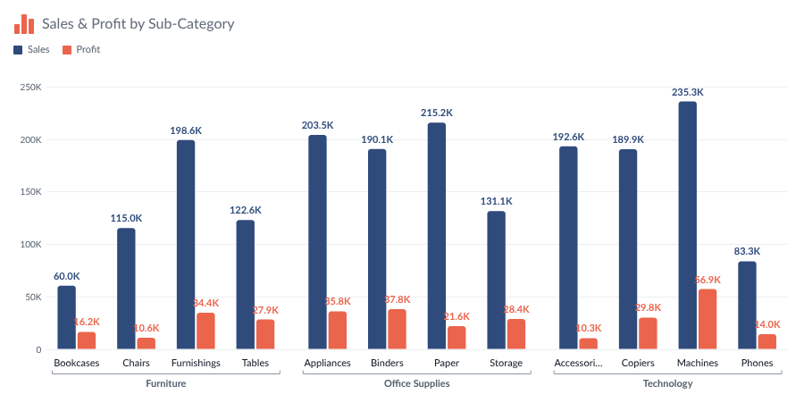

# Bar Chart — Tableau Viz Extension

A bar chart for every common bar design: vertical or horizontal, grouped, stacked, 100% stacked, left-right
comparison and overlapping bars, as plain bars, lollipops or filling (progress) bars, with a line on top, targets,
reference lines, icons per member, comments, Top N with *Others*, and drill-down on double-click. The icon, title and
explanation are the same as **KPI Card**; the card options and number formatting are the same as **Waterfall**.



```
bar-chart.trex   manifest: Marks card tiles + "Format Extension" button
index.html       chart page
chart.css/js     header, legend, data reading, drawing, tooltip, right-click menu, drill-down, comments
configure.*      Format dialog (every option below)
config.js        shared defaults, number and date formatting, colour palettes
icons.js, icons/extension/ the 14 Figma icons from *Icons for Extension* (same files as KPI Card)
fonts/           Lato 2.0 (OFL), WOFF2 Latin subset
serve.py/.sh     local server on :8769, also lists Tableau shape palettes
dev/             browser preview with sample data (no Tableau needed)
```

The builder guide (`Bar Chart - Builder Guide.pptx`) and `Development Resources/` stay out of git.

## Run it

```bash
chmod +x serve.sh && ./serve.sh
```

In Tableau Desktop (2024.2+): Marks card → mark type dropdown → **Add Extension** → **Access Local Extensions** →
`bar-chart localhost.trex` (in the `tableau-extensions` folder; it points at `http://localhost:8769`).

To try it without Tableau, open <http://localhost:8769/dev/preview.html>. It has twelve sample data sets (three Dimension
fields + line + target, dates, two and three measures, 100% stacks, ratios, negatives, Category › Sub-Category, Age group › Gender, raw large
numbers, Measure Names, 25 countries for Top N) and opens the Format dialog next to the chart.

Tableau allows a viz extension at most **four** tiles of its own. Tableau's own **Tooltip** tile is always on the Marks
card too; measures there become tooltip rows.

| Marks card tile | What to drop | Drives |
| --- | --- | --- |
| **Dimension** | 0–6 dimensions, outermost first (e.g. Category, Sub-Category, Region) | the first ones make the bars (Chart type → *Bars are*, default the first field; outer ones group the bars). The rest are the **breakdown**: tooltip rows, bar segments and drill-down levels. Empty = one bar per measure |
| **Measure** | one or more measures, dropped **one at a time** | the bar lengths. Two or more measures stand side by side, stack, or compare left-right |
| **Line** | up to 4 measures (optional) | lines over the bars, on the bars' axis or their own |
| **Target** | one measure (optional) | a target marker on every bar; progress bars can fill up to it |
| **Tooltip** (Tableau's) | measures (optional) | extra rows in the tooltip |

- **Axis type** (Chart type tab): automatic, dimension, date or Measure Names. Dates are sorted and labelled as dates
  (Jan 2026, Q1 2026 …). Measure Names makes one bar per measure; Dimension fields then group them.
- Values from finer rows (breakdown fields, dimensions on Detail) are **added up** per bar. For averages and ratios, use
  measures that aggregate correctly at the bar level, and set *Others* to *Average*.
- **Show every Dimension field** (Chart type tab): bars at the innermost field with the outer ones as groups, no
  double-click needed.
- **Bars split by** (Chart type tab): the measures, or the values of the **last** Dimension field (like a dimension on
  Tableau's Color). Automatic uses the last field when there's one measure and the layout is stacked, 100%, left-right
  or overlapping. Left-right needs exactly two values (e.g. Male / Female).
- **"Each bar is"**: Colors (Highlight), Groups (custom) and Member icons let you say what a bar's name is — its own name,
  its measure name, or the value of any Dimension field (e.g. one icon per Category, shared by its Sub-Categories).
- If Tableau delivers the measures as *Measure Names / Measure Values*, the extension pivots them back.

## In the chart

- **Hover** a bar: tooltip with the full value, % of total, % of the category, change vs the previous bar, target and
  % achieved, the breakdown (or every series of the category), line and Tooltip-tile values, and comments. Other bars
  fade.
- **Click** a bar: the tooltip stays (pinned) and lists every row; click *Name* or *Value* in its header to sort.
- **Double-click** a bar: drill down into the next Dimension field. Three modes (Breakdown & drill tab):
  *expand that bar and keep the others*, *show only that bar's detail*, or *expand every bar*. A Back / Reset bar
  appears above the chart.
- **Right-click** a bar: format its colour, add a comment, drill down / up / collapse, keep only, hide, highlight,
  and quick links to the Format tabs. Viz extensions can't add to Tableau's own right-click menu, so this is the
  extension's own menu.
- **Legend**: click an item to hide / show it, hover to highlight it.
- **Comments**: right-click → *Add comment*. They're saved in the workbook (while authoring), shown as a marker (dot,
  flag, pin, bubble) or a callout, and listed in the tooltip and on the Comments tab.

## Format dialog

**Format Extension** at the bottom of the Marks card, or right-click the chart. The dialog is modeless, so the chart
updates as you change things. **Cancel** undoes everything since the dialog opened; **Reset tab** restores that tab's
defaults.

| Tab | Options |
| --- | --- |
| Icon | as KPI Card: built-in Figma icons (default: bar chart), Tableau shapes, upload, size, colour |
| Title & text | as KPI Card: show, text (empty = "Measure by Dimension field"), alignment, font, size, weight, colour, italic; explanation with *Keep space when empty* |
| Chart type | **Quick looks**: 22 one-click designs modelled on the reference images (see below) · orientation · layout (regular, stacked, 100%, left-right / up-down, overlapping) · style (bar, lollipop, filling / progress) with their settings · axis type · grow animation |
| Bars | width (% or px) · gap inside a group (negative = overlap) · gap between groups · end shape (rounded, pill — fully round even on short bars, square, arrow) and radius · round value end only or both ends · fill (solid, gradient along / across, two-tone) · opacity · border (width, colour, opacity, style) · drop shadow (colour, opacity, blur, offset) · hover fade |
| Colors | colour by: **one colour** · **measures** (palette or a colour per measure, renamable) · **dimensions** (palette or a colour per value of any Dimension field; a field deeper than the bars splits them into coloured segments) · **gradient by value** (of any measure) · **positive / negative** · **highlight some bars** (pick measure names or values of any Dimension field, or the top N) · palette swatches editable by double-click · colour rules (value > / < … → colour) |
| Labels | place (outside end, inside end, middle, base, aligned column) · what to show (value, % of total, % of category, value and %, difference / % difference from previous, rank, name: value) · which bars (all, highest/lowest, first, last) · **overlapping labels: hide smaller ones / shrink then hide / show all** · size, weight, italic · colour (automatic, bar colour, **blend of the bar colour**, custom) · badge (pill, box, tag, circle, ring, hexagon, diamond) · stacked segment labels and totals · number format |
| Axes | value axis: starts at zero / close to the data / fixed, maximum, ticks, reversed, side, title, font, line, number format · **clipped bar marker** when the axis doesn't start at zero (slanted, zigzag, gap) · category axis: names on the axis, in coloured pills, inside the bar, rotated inside, beyond the bar end · side, direction, label width, alignment, max lines, skip overlapping names, title, font, colour like the bar, date format, axis line |
| Sort & Top N | sort by data order, value, name or date (by the total or one measure) · **Top N** (largest or smallest) of any Dimension field, ranked **within each value of the field before it** or **across all values**, by any measure (e.g. top 3 Sub-Categories in every Category by Sales while showing Sales and Profit, or the top 3 Sub-Categories overall), with the rest as **Others** (label, colour, sum or average, always last) · hidden bars · nulls |
| Lines & targets | value gridlines, lines between categories, zero line · **reference lines and bands** (average, median, min, max, percentile, constant, total; per series; label with `{type}` / `{value}`) · target markers (Target tile) (line, dot, triangle) |
| Line Chart | per Line measure: name, colour, width, style, straight / smooth / steps, opacity, area fill, markers, values on the line · line axis (own or shared, synced range, start, end, labels, format) |
| Legend | position (top, bottom, left, right), align, order, marker shape and size, totals, include lines / target / references, title, font, click to hide, hover to highlight, box |
| Member icons | an icon per bar (by its name, measure name or a Dimension field's value): built-in, Tableau shape or upload (logos, flags, photos) · place (on the axis, inside at base / middle / end, beyond the end) · size, gap, background (square, rounded, circle) and its colour, icon colour, accent bar, fallback icon |
| Groups | automatic (outer Dimension fields and drill parents), custom groups you name and assign by bar name, measure name or a Dimension field's value, or none · line (solid, dashed, dotted, bracket), colours, text, group total, shading |
| Breakdown & drill | Waterfall's breakdown options (Dimension fields after the bars' ones): split bars into segments, which fields and their order, separator, order, colours (shades or custom), dividers, segment values · drill-down on/off, mode, child shades, Back bar |
| Tooltip & actions | tooltip parts (Tooltip tile measures included), full numbers, sort, rows on hover, pin on click · right-click menu · double-click (drill, format, nothing) · click selects in Tableau (for dashboard actions) |
| Comments | show, marker or callout, marker style, colour, callout size and width, author · edit, recolour and delete every comment · add a comment to any bar |
| Numbers | **all numbers the same** or **each part its own** · K / M / B / dynamic / full / % / dynamic % / workbook format · 0–1 ratio · decimals · thousands separator · unit, position, space · "+" sign · negatives as −201.4, -201.4 or (201.4) · chart font |
| Card | as Waterfall (without the divider): padding, space above the chart, background colour and opacity, plus a chart-area background |
| Presets | **export** the settings as a preset (*look only* or *everything*): download a `.json`, copy it, or save it to **My presets** (kept on this computer for this extension, any workbook) · **import** from a file, pasted text or My presets, keeping this chart's colours, names, icons per member, groups, comments and title text if you like · Cancel undoes an import |

### Quick looks

Each one sets the look of a reference design in one click and keeps your data, member colours, icons and sorting:
bold columns, shaded by value, gradient rows, stacked rows, left-right comparison, ranking with icons, ranked list
with the axis on top, names inside the bars, 100% rows on a dark panel, rounded overlapping bars, filling tubes,
lollipops with rings, hexagon value badges, icons with two-tone bars, value pills, grouped soft gradient, highlight +
median line, table with bars, bars + line with diamond labels, slim bars with tags, outlined pills with ring labels and
progress rows. Fine-tune any of them on the other tabs.

## Settings and deploying

Everything is stored in the workbook under one settings key. Series, line and member settings are stored by name
(e.g. `SUM(Sales)`, `West`), so renaming a pill or a member starts that item from the defaults. Renamed pills are still
matched to their data columns by position.

1. The Tableau Extensions API library is bundled in `lib/tableau.extensions.1.17.0.min.js` (no CDN).
2. Run `python3 stamp-versions.py` before every commit (cache-busting for GitHub Pages).
3. Host the folder over HTTPS (GitHub Pages: `Cobani/bar_chart_extension`) and check `<source-location><url>` in
   `bar-chart.trex`.
4. Add the URL to the Tableau Server extension safe list. `dev/` doesn't need to be deployed.

Tableau reads the `.trex` only when the extension is added, so after editing it, remove the extension and add it again.

### Fast reload (last-render cache)

After each successful render the extension saves its data in the browser (localStorage, per Tableau Server and
worksheet). On the next load it draws that right after the Tableau handshake, then replaces it with the live data. If
the fields on the Marks card changed, the saved drawing is removed as soon as Tableau reports the fields. Saved results
older than 30 days are ignored.

### Load timings (debug)

In DevTools, pick this extension's frame in the Console, run `localStorage.setItem('extDebug', '1')` and reload. Each
load prints a table of steps and files. `extTimings()` prints it on demand; `localStorage.removeItem('extDebug')`
turns it off. In the dev preview, add `?debug` to the URL.
